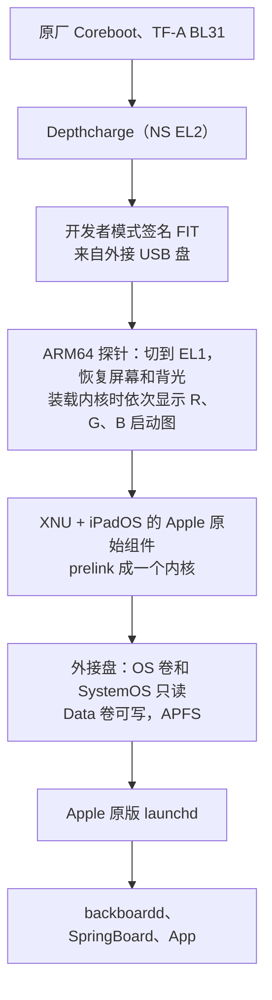
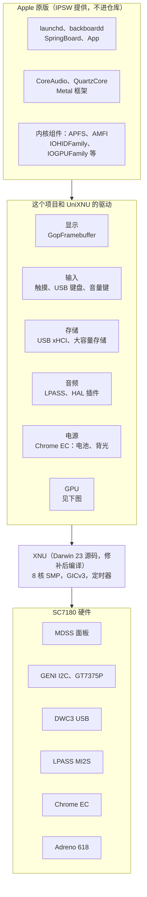
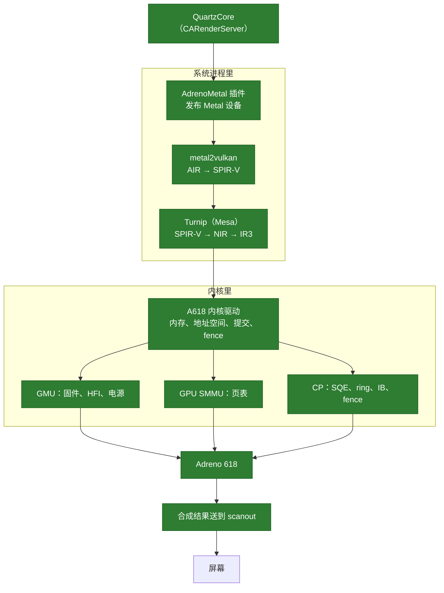
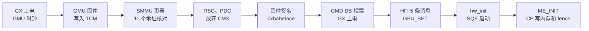

# Trogdor-ipadOS

HP Chromebook x2 11（Google Coachz / SC7180，骁龙 7c）的 **原生 iPadOS 移植实验**。不是虚拟机：原厂固件链启动，XNU 直接跑在这颗芯片上。

从外接 USB 盘启动 iPadOS 17.7.11，界面由 Adreno 618 经 Metal 合成上屏，触摸、键盘、声音、电池和背光可用，八个 CPU 核都在工作。每一部分的状态和证据见[当前进度](#当前进度)。这是一个实验项目，离日常使用还很远。

## 架构

### 启动链

原厂固件一个字节都不改，靠开发者模式的签名 FIT 进入自己的代码。



### 系统分层

上面是 Apple 的原版程序和组件，下面的驱动把它们接到这台机器的硬件上。硬件知识来自主线 Linux，iPadOS 适配的做法来自 UniXNU。



### GPU

这是目前的重点。路线很明确：**硬件这边照主线 Linux，iPadOS 这边用 UniXNU 现成的 Metal 翻译层**，中间的 A618 内核后端是这个项目改编的。Turnip 只依赖一组固定的内核接口，所以上层基本不用动。

图里每一层都在真机上跑通了。和性能有关的做法：IO 一致性（导入内存不在每次提交前后清理缓存）、DDR 和内存总线的带宽投票、LLCC 系统缓存、系统内存渲染（tile 内存不更快，还会红蓝互换）、着色器预热、按负载调频。



GPU 的启动顺序，寄存器和顺序都按主线 Linux：



之后 GPU 保持开机，板级代码把它交给 Turnip 和 Metal。详情见 [GPU 计划](docs/plans/gpu.md) 和 [硬件记录](docs/hardware-tests.md)。

## 当前进度

| 阶段 | 状态 | 证据 |
| --- | --- | --- |
| 原厂启动链、EL2→EL1、日志回传 Linux | 通过 | 真机日志，逐字段校验 |
| XNU 早期检查点（入口、MMU、高地址、C 入口、CPU 数据、PE、拓扑） | 通过 | 真机日志，逐字段校验 |
| 恢复屏幕和背光 | 通过 | 真机日志，加肉眼可见的棋盘格 |
| XNU 内核初始化走完，第一个程序和定时器中断 | 通过 | 屏幕照片 |
| prelink 31 个 Apple 组件（其中 1 个无代码，另加 tmpfs），原版 AMFI 放行 | 通过 | 屏幕照片 |
| XNU 里的 USB 存储驱动，经 GPT 和 APFS 挂载根卷 | 通过 | 屏幕和日志；未封存的根卷是放行，不是验证 |
| 从外接盘启动主系统，进入主屏幕和 Dock | 通过 | 屏幕照片 |
| 外接 Data 卷可写 | 通过 | 日志；跨重启的持久性有实际使用，没有单独验收 |
| 触摸 | 通过，偶尔中断 | 经 GENI I2C 和内核 `IOHIDEventDriver` 接到 backboardd；密集触摸后控制器曾停发中断几十秒，现在连续读取并在中断停住时主动轮询，仍在观察 |
| App | 部分 | Safari 和设置能启动；带云朵的 App 是占位符；小组件显示为白块；“设置 → 关于本机”打不开 |
| 电池、背光、Zed 键盘 | 通过 | 状态栏电量和 Debian 一致，亮度滑块和键盘可用 |
| 音量键 | 部分 | 按键能到 HID；音量条还没确认 |
| 系统音频 | 通过（听感） | 经原版音频服务播放，机主听到正常，日志无校正、无崩溃；路由显示为 iPad，图标是音响；麦克风没接 |
| 内存 | 通过 | XNU 用上 4 GiB 地址以上连续的 6 GiB，约 5.83 GiB 可用 |
| SMP 和 CPU 调频 | 部分 | 八个核上线，IPI 正常，空闲核优先选 A76；按负载每 16 ms 调频（UniXNU 的规则），触摸和 GPU 工作时拉高；没有休眠，不是真正的大小核调度 |
| 温控 | 部分 | 25 路温度可读；超过 80 °C 降低 CPU 档位和 GPU 上限，自检时档位寄存器读回正确，实际降频没有单独测 |
| 内存带宽 | 通过 | 按主线公式给 DDR 和内存总线投票后，内存延迟从约 195 ns 降到 135–140 ns，带宽和 Debian 一致 |
| 温度、加速度计、合盖 | 只读 | 能读到值；没有接温控和 CoreMotion，屏幕不会自动旋转 |
| GPU 启动和命令执行 | 通过 | CP 经 SMMU 从 ring 和 IB 写内存，fence 到达，所有故障寄存器为 0 |
| GPU 合成界面（Metal、Turnip） | 通过，还不够流畅 | 提交到完成平均约 18–23 ms，每次提交都完成、无故障；送显时 GPU 把一帧拷进帧缓冲平均约 8–10 ms（每个线程搬 4 个像素，原来 24 ms），其中 GPU 执行只有约 2 ms，其余在用户态的编码和提交上；还没有直接扫描输出；GPU 进程崩溃时释放缓冲区的 panic 已修；App 自己用 Metal 还没确认，没有 GPU 中断和电源管理 |
| GPU 调频 | 通过 | 档位切换实测应答 18–60 µs、测得 179–800 MHz；按 UniXNU 的规则让 GPU 约一半时间忙碌，触摸后用最高档 |
| Wi-Fi、蜂窝网络 | 部分 | 照主线 `qcom_q6v5_mss` 启动 modem，经 SMP2P 报告 ready；AP 这边有 GLINK、QRTR 和 rmtfs（EFS 在内存里），modem 一直运行并通告了 WLAN 固件服务（WLFW）等服务；WCN3990 本身（ath10k 那层）还没接，没有网络 |

屏幕照片阶段没有逐字段核对。有一个原因不明的随机 zone panic，没有解决；长时间稳定性没有验证。详情见 [状态](docs/status.md) 和 [硬件记录](docs/hardware-tests.md)。

## 站在谁的肩膀上

- **主线 Linux**：Coachz 是主线正式支持的整机，设备树和驱动给出了硬件的答案。Linux 是 GPL，这里只取事实和顺序，代码自己写。
- **[UniXNU](https://github.com/UniXNU)、UniXNU-sheng**：非 Apple 硬件跑 iPadOS 的框架，prelink、显示、触摸、音频和 GPU 的路线都来自这里。改编的文件保留了出处和协议。
- **ios-sweet**：屏幕控制台，以及系统启动问题的排错记录。

## 已有内容

- [原厂启动链研究](docs/native-boot.md)：固定到 Trogdor 固件维护分支，记录显示关闭、CPU 交接、内存与 FIT 格式的证据。
- [设计与阶段边界](docs/design.md)：比较直接 FIT shim、U-Boot EFI 与替换固件，明确首阶段的接口。
- `boot/`：带 Linux ARM64 Image 头的独立探针、EL2→EL1 入口、内存日志、受限 GENI UART 输出、只读 FDT 解析。
- `tools/`：交叉编译、FIT 封装、vboot 容器签名、上游版本核对；所有产物都是普通文件。
- `platform/`：`coachz` 是已验收检查点用的内核；`coachz-screen` 是不带 prelink 的屏幕内核；`coachz-prelink` 是主系统路线用的内核，所有驱动都在这里。
- [计划](docs/plans/)：GPU、Wi-Fi、音频等每个驱动的路线和真机上要看什么。
- [状态与真机验收](docs/status.md)：区分源码证据、主机检查、已通过的探针硬件验收与后续阶段。

## 构建

需要 Python 3、主机 C 编译器，以及 Zig 0.15.2。工具链可安装在项目内：

```sh
python3 -m pip install --target .tools/ziglang ziglang==0.15.2
python3 tools/build.py
python3 -m unittest discover -s tests -v
```

也可用环境变量 `ZIG` 指定已有的 Zig 可执行文件。

默认生成 memory、uart、reset-el2、reset-el1 四种探针：

| 产物 | 用途 |
| --- | --- |
| `build/memory/Image`、`probe.elf`、`probe.map` | 不访问外设的内存日志探针 |
| `build/uart/Image`、`probe.elf`、`probe.map` | 在原厂已经配置好 UART 的前提下，尝试输出日志 |
| `build/coachz-probe.dtb` | 仅供单核探针使用的最小 FIT 设备树；不是未来 XNU 的完整硬件描述 |
| `build/memory/probe.itb`、`build/uart/probe.itb` | 未签名 FIT；包含 Image 与探针设备树 |
| `build/manifest.json` | 实际使用的编译器、产物 SHA-256 与 Image 头信息 |

探针设备树的 `model` / `compatible` 是打包输入，不能当作真机身份探测结果。Depthcharge 会补入实际内存、原厂表位置等数据，探针记录这些交接信息。

构建对最终 ELF 的 AArch64 指令范围执行 [标量生成码检查](docs/codegen.md)，禁止早期探针依赖 FP／SIMD／SVE，并显式启用严格对齐。

## 无串口测试

见 [USB 测试步骤](docs/usb-test.md)。`reset-el2` 完成 EL2 诊断后等 3 秒复位；`reset-el1` 完成 EL1 诊断后等 10 秒复位。它们都不提供屏幕输出，观测到预期的成对延时重启只算粗粒度执行证据，不包含寄存器读数或 XNU 启动验证。

两种定时镜像观察到自动重启，普通内存对照与仅取消最终复位指令的匹配对照均不重启。单指令匹配对照为原版到达最终复位调用及此前 EL1／诊断门限提供间接硬件证据。后续 Linux 接收路线已取得直接寄存器日志；此前定时实验仍没有精确计时。见 [硬件记录](docs/hardware-tests.md)、[EL1 匹配对照](docs/control.md)与 [可读日志通道](docs/observability.md)。

在 Debian 构建／测试环境中，可使用已安装的 `futility` 和公共开发者测试密钥创建两个 64 MiB GPT 镜像：

```sh
python3 tools/prepare_usb.py
```

默认查找 `/usr/share/vboot/devkeys`、`/usr/share/vboot/devkeys-pkc` 和锁定的上游 `tests/devkeys`；也可用 `--key-dir` 指定。该命令只签名并创建文件，拒绝设备输出路径和覆盖已有文件。

## 签名

在具备 ChromiumOS `futility` 和开发者测试密钥的构建环境运行：

```sh
python3 tools/sign.py build/uart/probe.itb \
  --futility /path/to/futility --key-dir /path/to/devkeys \
  --output build/uart/probe.kpart
```

该命令仅创建并核验 vboot 容器，不写磁盘或固件。项目不提供自动刷写命令。将镜像放进可启动介质以及真机日志采集，是单独的硬件阶段。

## 当前可观测结果

探针在静态符号 `probe_log` 对应的内存中记录入口 EL、SCTLR、HCR、切换后的 EL、计时器频率、FDT 校验和交接属性；memory / uart 版本记录完成后停在 `WFE` 循环；定时复位版本在满足检查条件后请求重启。UART 版本只复用已初始化的 SC7180 QUPv3 UART，不下载固件，不改时钟或引脚；不可用时保留内存日志。

这一步不会恢复屏幕。已核对的 Depthcharge 源码会停止 timing engine、关闭背光并清零 DSI control，显示恢复需要独立验证；复用固件显示链的依据与待核对项见 [显示审计](docs/display-reuse-audit.md)。

## 原生 Linux 日志接收

已实现独立诊断路径：探针在 EL1 记录，受控 HVC 返回 EL2，交接保留的原生 Linux，在 chosen 设备树属性中读取日志。见 [构建与验收契约](docs/linux-log.md)。它使用现有原生 Linux 容器作为私有输入，不包含虚拟机，也不改变后续 iPadOS 引导目标；2026-10-27 已在真机启动并读回有效日志，确认 entry EL=2、current EL=1、stage=3、handoff EL=2。

## XNU 源码与装载前准备

下一阶段的源码入口、单核架构组件和主机装载检查见 [XNU 准备说明](docs/xnu-preparation.md)。`tools/kernel_source.py` 准备固定版本源码，`--build` 编译源码内核；`tools/xnu_prepare.py` 使用私有原厂 FDT／探针日志规划连续内存并生成最小 ADT，可选检查预链接 Mach-O 与 Darwin 23 boot_args。它们不生成新的可启动镜像，也不执行 XNU。

原生源码 XNU 的 pre-MMU 装载／boot_args 检查点见 [入口检查点](docs/xnu-checkpoint.md)。它已在真机通过单指令 HVC 返回 Linux 取回有效日志；后续 MMU、早期 C 参数复制、启动 CPU 数据及首次平台／ADT 查找检查点也已通过；后续平台初始化、平台驱动与 iPadOS 启动仍待完成。

[MMU 开启检查点](docs/xnu-mmu-checkpoint.md) 已通过真机日志验收：完整页表池、EL1 寄存器和硬件地址翻译校验成功，并返回 Linux。该轮只验证 MMU；随后高地址实际取指与栈读取由独立检查点确认。

[高虚拟地址与 C 入口检查点](docs/xnu-highva-checkpoint.md) 已通过真机验收：原始 RET 跳入 arm_init 高地址，完成栈帧调整与诊断读取后返回 Linux，未执行 C 初始化正文。

[早期 C 初始化与参数复制检查点](docs/xnu-cinit-checkpoint.md) 已通过真机日志验收：原始栈保存、完整参数复制、全局指针设置与缓存维护四个新字段及原有 11 字段全部通过，在 cpu_data_init 前返回 Linux；后续启动 CPU 数据及有限平台／ADT 查找的独立验收见下文。

[启动 CPU 数据初始化检查点](docs/xnu-cpu-checkpoint.md) 已通过真机验收：全部 16 字段有效，原始 cpu_data_init 的标量／FP/NEON 写入、完整 CPU 对象、保留哨兵与 guard 通过核对后返回 Linux。该有限检查点停在 PE_init_platform 前，不代表平台／ADT 初始化或完整系统启动。

[平台入口与原生 ADT 查找检查点](docs/xnu-platform-checkpoint.md) 已通过真机验收：完整 19 字段有效，正常 CPU 初值、原始平台状态与 ADT 绑定、原生 arm-io 查找及活动栈帧均通过核对后返回 Linux。检查点仍在后续 SoC 属性读取之前，后续平台／设备初始化与完整系统启动尚未验证。

[完整早期平台返回检查点](docs/xnu-pe-checkpoint.md) 已通过真机 22 个严格字段：完整 PE_init_platform(FALSE) 返回、SoC／型号／时钟结构／调试配置、父帧与缓存／页表返回均通过，随后进入 Linux。当前 ADT 缺失的总线／CPU 频率仍为零，clock info 只验证结构内容，不代表时钟驱动已支持。下一段 WFE／CPU 拓扑／线程／VM 的依赖和恢复契约见 [后续审计](docs/post-pe-audit.md)。

[SoC 属性诊断中点](docs/xnu-soc-checkpoint.md) 已由 version9 的真机日志验收：原始属性读取与缓存写入、全部 20 个严格字段、完整捕获／页表／硬件 AT 与缓存返回通过，随后交接 Linux。此前 version8 的无日志尝试保留为失败历史；本轮不覆盖后续 CPU／时钟／型号／调试配置或 SoC MMIO。

[同步异常与返回失败诊断](docs/xnu-diagnostics.md) 在修复包装器的绝对字符串指针缺陷后，已取得真机完整 BRK 异常记录并返回 Linux：精确故障位置／ESR、完整页表池与诊断传输均通过。此轮只验收异常回收通道，主动故障的 checkpoint=0 符合设计；随后 version9 的真实 SoC 属性路径也通过全部 20 个严格字段并正常返回 Linux。完整早期 PE 返回已在随后单独验收；完整系统启动、时钟／设备驱动仍未支持，主机验证证据单独保留。

[WFE 与单 CPU 拓扑检查点](docs/xnu-topology-checkpoint.md) 已实现 version11，126 项主机测试、七次系统模型回归和原生产物独立审查通过；检查三个系统寄存器的运行值和完整恢复，严格读取要求 40 字段。2026-10-31 真机完整 40 字段已通过，原始 WFE 配置／单 CPU 拓扑、完整状态核对与寄存器恢复后正常交接 Linux；不包含线程／VM 初始化。


[独立显示发现探针](docs/display-discovery.md) 已实现：校验 Coreboot framebuffer／GPIO 元数据，只读快照 13 个显示／GPIO／EC 协议寄存器，计算原 scanout 与整页分配范围的冲突，再 HVC 返回 Linux。137 项主机测试、11 次读异常 CPU 模型、旧 version11 回归及原生产物审查通过；2026-10-31 真机完整 42 字段通过，13 次读取无故障并正常交接 Linux。实际几何／格式匹配，候选为假的两个原因已经只读查明：当时的 1 MiB 基址门误读了分配器，复用的 XNU 放置范围门对动态 framebuffer 不可能为真，见 [核实记录](docs/display-discovery.md#2026-10-31真实分配与保留归属核实)。修正后的 schema 2 已通过真机 45 字段，候选为真。随后独立的画面实验恢复了 Depthcharge 停掉的 scanout：手电下可见全屏棋盘格，帧计数正好 60 Hz，并正常交接 Linux。随后的背光实验通过 EC 打开背光，不用手电即可看到棋盘格。发现探针本身不执行 XNU，不写 framebuffer、显示控制或 EC；候选标志不表示屏幕已点亮。

## XNU 屏幕输出与用户态

这部分镜像不再返回 Linux，结果都看屏幕。构建和配置见 [XNU 屏幕输出](docs/display-discovery.md#xnu-屏幕输出payload-version-12) 和 [prelink 屏幕镜像](docs/display-discovery.md#prelink-屏幕镜像)。

- 屏幕控制台改编自 ios-sweet，kprintf 和 panic 调用栈都画到屏幕上。
- 第一个用户程序是 `tools/coachz_init.S` 打包成的静态程序，由 mockfs 当作 `/sbin/launchd` 启动，每 5 秒打印一次 tick。
- 之后改用 IPSW 的 Update 恢复内存盘作为 APFS 根，运行 Apple 原版 launchd。内核每 60 秒打印一次存活信息和线程状态。
- SC7180 的虚拟定时器是 INTID 19，不是 ArmCpu 写死的 27，修正后定时器中断才开始工作。
- prelink 需要自己提供 IPSW。IPSW、kernelcache、合并后的内核和 GPU 固件都留在被忽略的目录里，不进仓库。
